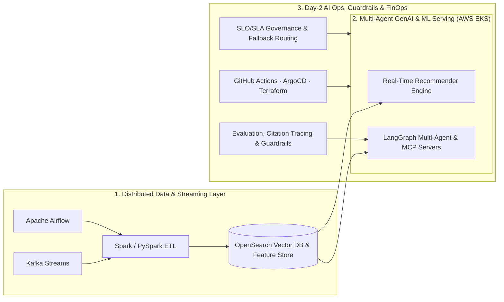

# 👋 Hi, I'm **Shankar Saran Singh**

### **Principal / Staff Data & AI Systems Architect · AI & Agent Operations Leader**
**Multi-Agent GenAI (LangGraph, MCP) · Real-Time Recommendation Engines · Distributed Data Platforms · Day-2 MLOps & SRE Governance**

---

## 🚀 Executive Profile

Visionary **Staff Engineer, Data & AI Systems Architect, and AI & Agent Operations Leader** with **13+ years** of deep expertise architecting and operating production-grade **Data Platforms, Real-Time Recommender Systems, End-to-End MLOps Lifecycles, and Multi-Agent Generative AI Ecosystems** across **Media, Banking & Financial Services, Telecom, and Gaming**.

- **Architecture at Scale:** Proven track record designing high-concurrency real-time personalization layers, semantic vector search platforms (**OpenSearch**), and distributed streaming/batch engines (**Spark, PySpark, Kafka, Airflow**) handling **millions of daily events and concurrent requests on AWS EKS**.
- **Agentic AI & Day-2 Operations:** Pioneered enterprise multi-agent workflows using **LangGraph** and **Model Context Protocol (MCP)** servers—enforcing automated evaluation frameworks, RAG citation tracing, hallucination guardrails, fallback routing, and evidence-based **go/no-go release gates**.
- **Reliability, MLOps & FinOps Leadership:** Directed 24x7 mission-critical operations, SLO/SLA error-budget governance, incident command, and Terraform-driven cloud FinOps—delivering measurable gains in deployment velocity, system resiliency, and infrastructure efficiency.

---

## 📊 Quantified Impact at a Glance

| Metric / Outcome | Enterprise Impact Delivered |
| :--- | :--- |
| **⚡ +40% Model Deployment Velocity** | Instituted standardized **CI/CD & GitOps pipelines** across software and ML lifecycles via **GitHub Actions, Jenkins, and ArgoCD**, reducing release risk and accelerating time-to-market. |
| **🚀 50% Faster Data Backfill Windows** | Architected high-throughput streaming and batch pipelines (**Spark, PySpark, Kafka, Airflow**) processing millions of daily events with optimized multiprocessing/multithreading. |
| **💰 25% Lower Annual AWS Spend** | Spearheaded **Cloud FinOps** and resource governance through **Terraform (IaC)** policies and SLO/error-budget enforcement on **AWS EKS** while upholding **24x7 high availability**. |
| **🛡️ 24x7 Multi-Publication AI Reliability** | Established **Day-2 AI/ML Operations**, automated evaluation & guardrail gates, citation tracing, and fallback routing across multi-publication newsroom and personalization estates. |
| **🏦 >90% Banking System Test Coverage** | Engineered zero-data-loss, low-latency streaming payment pipelines and automated **BDD (Cucumber)** quality gates for core international banking engines (**Crédit Agricole CIB**). |

---

## 🧠 Core Architectural & Operating Pillars

### 1. 🤖 Agentic AI, GenAI & Day-2 AI Operations
- **Multi-Agent Orchestration:** Production multi-agent workflows with **LangGraph** and **Model Context Protocol (MCP)** servers for automated content transformation, multilingual translation, summarization, and enrichment.
- **AI Governance & Safety Gates:** Automated evaluation pipelines, **RAG citation tracing**, bias & drift monitoring, explainability, prompt-injection/hallucination guardrails, and evidence-based **go/no-go handover gates**.
- **Resilient LLM Serving:** Validation layers, dynamic fallback routing, semantic caching, and real-time observability/tracing.

### 2. 🎯 Real-Time Recommendation & Vector Search Systems
- **Personalization Engines:** End-to-end real-time news and ad recommendation architectures combining semantic embeddings, user behavioral signals, and content profiling.
- **Enterprise Vector & Search Databases:** High-concurrency retrieval and ranking on **OpenSearch**, **Elasticsearch**, **MongoDB**, **PostgreSQL**, **HBase**, and **BigQuery**.

### 3. ⚙️ Distributed Data Engineering & Streaming Platforms
- **Batch & Real-Time Processing:** **Apache Spark**, **PySpark**, **Kafka / Kafka Streams**, **Apache Airflow**, **Hadoop Clusters**, and **AWS EMR**.
- **Performance Engineering:** Low-latency stream processing, zero-data-loss financial transaction pipelines, and parallelized multiprocessing/multithreading optimization.

### 4. ☁️ Cloud-Native MLOps, SRE & FinOps Governance
- **Cloud & Orchestration:** **AWS** (`EKS`, `ECS`, `S3`, `Glue`, `Redshift`, `SageMaker`, `EMR`, `EC2`), **Kubernetes**, and **Docker**.
- **CI/CD, GitOps & IaC:** **Terraform**, **GitHub Actions**, **ArgoCD**, **Jenkins**, and **MLflow**.
- **SRE & Incident Command:** 24x7 production reliability, **SLO/SLA & Error Budgets**, incident severity governance, rollback protocols, game days, and post-incident root-cause analysis (RCA).

### 5. 👥 Technical Leadership & Engineering Excellence
- **Architecture & Strategy:** Enterprise data/AI roadmaps, standardized architecture blueprints, and cross-functional alignment with executive and product stakeholders.
- **Team Enablement:** Engineering mentorship, rigorous code/design reviews, BDD/TDD quality culture, and multi-publication platform support.

---

## 🛠️ Technology Stack

-232F3E?style=flat-square&logo=amazonaws&logoColor=white)

---

## 🏛️ Featured Production Systems & Blueprints

1. **Multi-Agent Generative AI & MCP Platform (`LangGraph` · `MCP` · `RAG` · `AWS EKS`)**
   - Architected multi-agent workflows for automated newsroom content transformation, multilingual translation, summarization, and metadata enrichment.
   - Embedded **RAG-based citation tracing**, automated bias/hallucination checks, validation layers, and resilient fallback routing across LLM providers.
2. **Real-Time Personalization & Recommendation Engine (`OpenSearch Vector DB` · `Embeddings` · `EKS`)**
   - Designed the end-to-end blueprint serving millions of low-latency news and advertising recommendations across multi-publication digital estates.
3. **High-Throughput Streaming & Batch Data Platform (`Spark` · `PySpark` · `Kafka` · `Airflow` · `EMR`)**
   - Built fault-tolerant pipelines processing millions of daily events, cutting enterprise backfill windows by **50%** via parallel execution tuning.
4. **Unified MLOps, GitOps & FinOps Governance (`Terraform` · `ArgoCD` · `GitHub Actions` · `Jenkins`)**
   - Standardized model training-to-production pipelines (**+40% deployment velocity**) and Terraform cost-governance policies (**-25% annual AWS spend**).

---

## 💼 Career Journey & Experience

### **Staff Engineer – AI & ML Operations / Data & AI Architecture** | **SPH Media** *(Singapore · Jul 2019 – Present)*
- **Technical Vision & Day-2 AI Governance:** Direct architectural roadmap and Day-2 operational strategy across classical ML platforms and multi-agent Generative AI workloads on **AWS EKS**, guaranteeing 24x7 reliability across multi-publication estates.
- **Agentic Orchestration & Quality Handover Gates:** Pioneered **LangGraph** and **Model Context Protocol (MCP)** workflows with automated evaluation, observability, citation tracing, and evidence-based go/no-go release gates.
- **Data & AI Personalization Engine:** Architected real-time analytics and recommendation services powered by semantic embeddings, behavioral signals, and **OpenSearch** vector databases.
- **Distributed Data Platform Delivery:** Designed high-throughput **Spark, PySpark, Kafka, and Airflow** architectures processing millions of daily events (**50% faster backfills**).
- **MLOps, SRE & FinOps Leadership:** Instituted standardized CI/CD & GitOps pipelines (**+40% deployment velocity**) and Terraform resource governance (**25% AWS cost reduction**) while leading incident command and executive stakeholder alignment.

### **Senior Big Data Developer / Reliability Lead** | **Adecco (Client: Crédit Agricole CIB)** *(Singapore · May 2018 – Jun 2019)*
- **Mission-Critical Banking Streaming:** Engineered low-latency, zero-data-loss streaming pipelines for core international banking payment engines.
- **DevOps & Quality Engineering:** Orchestrated automated Hadoop cluster releases and maintained **>90% test coverage** using unit and **BDD (Cucumber)** testing frameworks.

### **Senior Big Data Developer** | **Xavient Information Systems** *(India · Aug 2016 – Apr 2018)*
- **Audience Intelligence & Personalization:** Designed scalable ETL frameworks, user-profiling architectures, and targeted ad-segmentation pipelines over massive historical datasets.

### **Senior Software Developer** | **NetAmbit Infosource & e-Services Pvt. Ltd** *(India · Apr 2015 – Aug 2016)*
- **End-to-End SDLC Leadership:** Led requirement analysis, system architecture, security compliance, and production release management.

### **Full Stack Developer** | **Protolink Technologies** *(India · Aug 2012 – Apr 2015)*
- **High-Concurrency Backend Engineering:** Built resilient backend services supporting an international online gaming platform.

---

## 🎓 Global Certifications, Awards & Education

- 🏆 **Award:** **2nd Runner-Up** — *Project Management Institute (PMI) Singapore Chapter*
- 🎓 **Education:** **Bachelor of Science (B.Sc.)** — *Chhatrapati Shahu Ji Maharaj University, India*
- 📜 **12+ Global Certifications:**
  - *Generative AI Architectures with LLM, Prompt, RAG & Vector DB*
  - *Mastering System Design: Software Architecture & Design of Modern Large-Scale Systems*
  - *Apache Spark Essential Training: Big Data Engineering*
  - *Architecting Big Data Applications: Real-Time Application Engineering*
  - *Artificial Intelligence Foundations: Machine Learning*
  - *Stream Processing Design Patterns with Kafka Streams*
  - *Plus 6+ additional credentials across Cloud Architecture, MLOps, Kubernetes, and Data Governance*

---

## 📫 Let's Connect

- 💼 **LinkedIn:** [linkedin.com/in/shankar-saran-singh](https://www.linkedin.com/in/shankar-saran-singh)
- 📧 **Email:** [shankarsaran620@gmail.com](mailto:shankarsaran620@gmail.com)
- 📍 **Location:** Singapore
